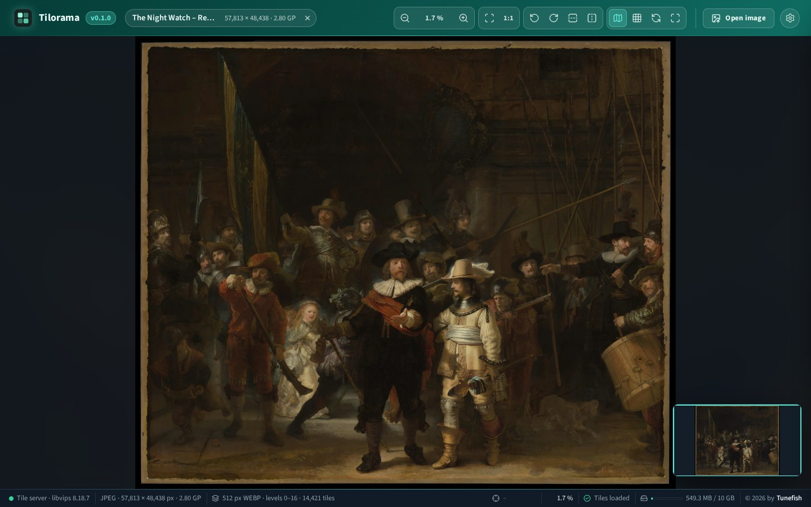
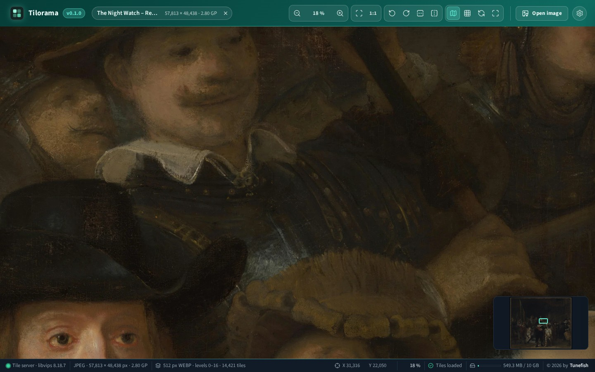
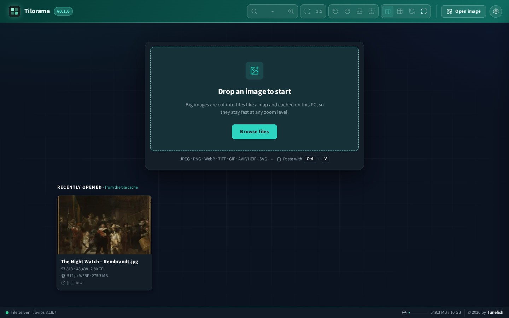
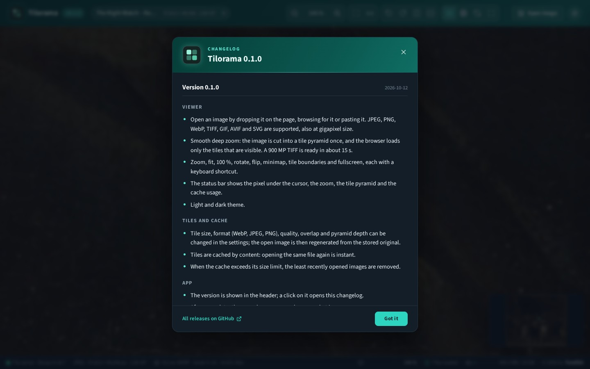

# Tilorama

[](https://github.com/Tunefish92/Tilorama/actions/workflows/ci.yml)
[](https://github.com/Tunefish92/Tilorama/releases)
[](LICENSE)

A fast deep-zoom image viewer. Drop in an image (or browse or paste it). A local server cuts it into a
tile pyramid, like Google Maps, and caches the tiles on disk. The browser then streams only the tiles that
are currently visible, so a gigapixel image opens and pans as smoothly as a photo.



Zoomed in on the same image, down to the brush strokes:



| Start page with the recently opened images | What is new, shown once after an update |
| --- | --- |
|  |  |

The image in the screenshots is Rembrandt's *The Night Watch* (1642) as photographed by the Rijksmuseum at
57,813 × 48,438 px. Painting and photograph are in the public domain
([file on Wikimedia Commons](https://commons.wikimedia.org/wiki/File:The_Night_Watch_-_HD.jpg)). Tilorama
cut it into 14,421 tiles in 36 seconds.

- **Frontend:** React 19 + TypeScript + Vite; [OpenSeadragon 6](https://openseadragon.github.io/) (WebGL) renders the tiles
- **Backend:** ASP.NET Core (.NET 10) minimal API; [libvips](https://www.libvips.org/) via NetVips generates the tiles

## Run with Docker

```sh
docker run -d --name tilorama -p 127.0.0.1:8080:8080 -v tilorama-data:/data ghcr.io/tunefish92/tilorama:latest
```

Open http://localhost:8080. Uploaded originals, tiles and settings are kept in `/data`. The image is built
for `linux/amd64` and `linux/arm64`.

With Docker Compose: download [docker-compose.yml](docker-compose.yml) and run `docker compose up -d`. It
keeps the data in `./tilorama-data`.

| Variable | Default | Effect |
| --- | --- | --- |
| `PUID`, `PGID` | `1000` | The user the app runs as and that owns the data folder |
| `TileCache__Root` | `/data` | Data folder inside the container |

Tilorama has no login: everyone who can reach the port can open images and clear the cache. The commands
above bind it to this machine only. Publish the port as `-p 8080:8080` only on a network you trust.

## Run from source

Requirements: .NET 10 SDK and Node.js 20.19 or newer. Works on Windows and Linux (x64 and ARM64); libvips
comes with the NuGet packages.

```sh
npm install          # installs the root tooling and client/
npm run dev          # tile server on :5080 + Vite dev server on :5173
```

Open http://localhost:5173.

Single process (production-like): `npm start` builds the client into `server/Tilorama.Server/wwwroot`
and serves app, API and tiles at http://localhost:5080.

Tests: `npm test` runs the backend tests, lint and a type-checked client build.

## How it works

```
Browser ── XHR upload (progress, speed, ETA) ──► POST /api/images
   ▲                                              │ streamed to disk + SHA-256
   │ SSE progress (/api/jobs/{id}/events)         ▼
   │                                   JobQueue ─► TilingService (libvips dzsave)
   │                                              │
   └──── GET /tiles/{id}/image_files/{level}/{col}_{row}.webp ◄── {cache}/tiles/{id}/
```

- **Cache key:** content hash + tiling settings (e.g. `3f2a…_t512-o1-webp-q85-px`). Opening the same
  file again is instant, and tiles are served with `Cache-Control: immutable`.
- **Huge images:** libvips streams the image top to bottom. Tiling a 900 MP TIFF takes about 15 s and peaks
  around 360 MB of RAM.
- **Atomic publish:** pyramids are written to a `.partial-*` folder and renamed when complete. A cancelled
  or crashed job never leaves half-written tiles behind.
- **LRU eviction:** when the cache exceeds its limit (Settings → Cache), the least recently opened images are removed.
- **One job at a time:** libvips already uses every core for a single image.

Supported formats (bundled libvips): JPEG, PNG, WebP, TIFF, GIF, AVIF/HEIF, SVG.

The cache folder is `tilorama-tiles` in the system's temp folder (`%TEMP%` on Windows, `/tmp` on Linux) and
`/data` in the Docker image.

## Settings

| Setting | Stored in | Effect |
| --- | --- | --- |
| Tile size, format, quality, overlap, zoom levels (pyramid depth) | server, `settings.json` in the cache folder | New tile set; the open image can be regenerated from the stored original |
| Cache size limit | server | LRU eviction |
| Max zoom, wheel zoom step, animation, minimap, tile boundaries, theme | browser (localStorage) | Applies immediately |

The cache folder can be changed with `TileCache:Root` in `appsettings.json` or the `TileCache__Root`
environment variable.

## Versions and updates

The version is shown in the header; a click on it opens the changelog. After an update, the page shows once
per browser what is new. When a newer release is on GitHub, an **Update available** badge appears beside
the version and links to its release notes. For this check the browser asks GitHub's public API for the
releases of this repository, at most every six hours; nothing about your images is sent.

All changes are listed in [CHANGELOG.md](CHANGELOG.md).

### Making a release

1. Set the new version in `client/package.json` (`npm --prefix client version 1.2.3 --no-git-tag-version`).
2. Add a `## 1.2.3 – YYYY-MM-DD` section at the top of `CHANGELOG.md`. It is what the app shows after the
   update.
3. Commit, tag the commit `v1.2.3` and push both. The CI workflow then publishes the Docker image as `1.2.3`
   and `latest`.
4. Create the GitHub release for the tag. Running copies of Tilorama find it through their update check.

## Controls

Mouse wheel: zoom at the cursor · drag: pan · double-click: zoom in (Shift: out).
Keys: `O` open, `+`/`−` zoom, `0` fit, `1` 100 %, `R`/`Shift+R` rotate, `H`/`V` flip, arrow keys pan,
`M` minimap, `G` tile boundaries, `F` fullscreen, `S` settings, `Esc` close or cancel.

## Project layout

```
CHANGELOG.md                    built into the app ("what is new")
Dockerfile, docker-compose.yml  Docker image
client/                         React app
  src/api/                      typed API client (XHR upload, SSE job watcher)
  src/app/actions.ts            open / upload / regenerate / cancel flows
  src/store/                    Zustand stores (app state, live viewer stats)
  src/viewer/                   OpenSeadragon hook + imperative viewer commands
  src/lib/                      formatting, version comparison, changelog parser
  src/components/               Header, DropZone, ProcessingOverlay, Viewer, StatusBar, SettingsDrawer, ChangelogModal, Toasts
server/Tilorama.Server/  ASP.NET Core API
  Services/                     TilingService, JobManager, CacheManager, SettingsStore
  Endpoints/                    images, jobs (SSE), settings, cache
server/Tilorama.Tests/   xUnit tests (pyramid levels, cancellation, LRU)
```

## License

[MIT](LICENSE) © 2026 [Tunefish](https://github.com/Tunefish92)
